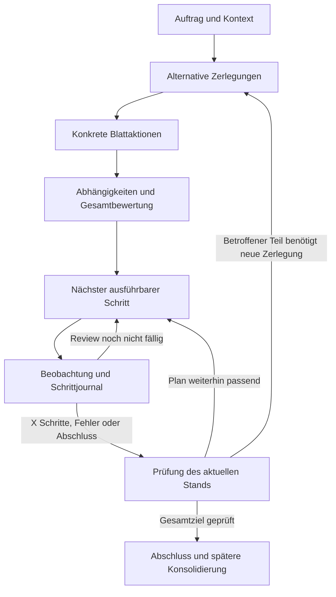

# C3P3 CODE — Hierarchische Planung, Funktionsfibres und regelmäßige Prüfung

Version V1 · 06.09.2026

**Status: Umsetzungskonzept als Erweiterung von `C3P3_CODE_SEMANTIK_MEMORY_ATLAS_GESAMTKONZEPT_V2.md`. Die hier beschriebenen Planungs- und Review-Komponenten sind noch nicht implementiert.** Die vorhandenen Memory-Verträge aus Paket A sowie die zwölf CODE-Phasen bleiben die Grundlage.

## 1. Ziel und verbindlicher Ablauf

C3P3 soll eine Aufgabe zunächst verstehen und in ihren Kontext einordnen, mehrere Lösungswege bilden, diese schrittweise in ausführbare Details zerlegen und daraus eine begründete Umsetzung planen. Während der Umsetzung prüft es nach jeweils X Schritten den aktuellen Stand und passt betroffene Teile des Plans an.

Der Novice soll dabei vier Fähigkeiten lernen:

1. Welche Zerlegung und welche Detailtiefe für eine Aufgabe hilfreich sind.
2. Welche Funktionen und Argumentbindungen die Teilziele erfüllen können.
3. Welche zulässige Reihenfolge unter den gegebenen Abhängigkeiten und Ressourcen vorteilhaft ist.
4. Welche Befunde eine Fortsetzung, Korrektur oder neue Zerlegung erfordern.

Der Master liefert Beispiele, alternative Zerlegungen und überprüfbare Hilfen. Die Planung bleibt langfristig eine zu lernende Aufgabe des Novice. Ein System, in dem der Master immer die vollständige Planung erledigt, würde diese Fähigkeit des Novice nicht nachweisen.

Der Ablauf besitzt zwei Richtungen: **von oben nach unten spezifizieren; von unten nach oben Machbarkeit, Aufwand und Gesamtplan bestimmen.** Neue Befunde aus der Ausführung können beide Richtungen erneut auslösen.

## 2. Ebenen der Planung

| Ebene | Frage | Verbindliches Ergebnis |
|---|---|---|
| 0 — Auftrag | Was soll erreicht werden? | Ziel, erwartetes Verhalten, Grenzen und überprüfbare Abschlusskriterien |
| 1 — Kontext | Welche vorhandenen Strukturen, Daten und Regeln sind relevant? | Gebundener Code-/Runtime-Stand, vorhandene Funktionen, Schnittstellen, Annahmen und offene Fragen |
| 2 — Lösungswege | Welche grundsätzlichen Methoden könnten das Ziel erfüllen? | Mehrere bedingte Lösungsalternativen mit begründeter Zerlegung |
| 3 — Teilaufgaben | Welche Teilergebnisse benötigt eine gewählte Methode? | Teilziele, benötigte Artefakte und fachliche Abhängigkeiten |
| 4 — Umsetzungseinheiten | Welche präzisen Änderungen oder Berechnungen erzeugen diese Ergebnisse? | Konkrete Aufträge mit Eingaben, Ausgaben, Prüfkriterien und Änderungsbereich |
| 5 — Blattaktionen | Was kann der Executor unmittelbar ausführen? | Gebundener Funktionsaufruf oder Patchkandidat mit vollständigen Argumenten und Runnervertrag |

Die semantischen Ebenen sind Rollen, keine vorgeschriebene Anzahl von Unterknoten. Eine einfache Aufgabe kann unmittelbar in eine Blattaktion übergehen. Komplexe Teilaufgaben werden rekursiv weiter zerlegt, solange dies innerhalb des konfigurierten Suchbudgets erforderlich ist.

**Abbruch der Verfeinerung:** Eine Einheit ist ausreichend konkret, wenn der Executor sie ohne neue fachliche Definition ausführen kann: Operation, Eingaben beziehungsweise eindeutig typisierte Referenzen auf Vorgängeroutputs, Artefaktbezüge, Voraussetzungen, erwarteter Ergebnisvertrag und Prüfweg sind bekannt. Eine Formulierung wie „die Logik sinnvoll verbessern“ erfüllt diesen Vertrag nicht. Konkrete Werte und Hashes noch nicht erzeugter Ergebnisse werden erst vor dem Aktionsstart gebunden.

Eine noch offene fachliche Frage wird als `unknown` mit einem Aufklärungsschritt geführt. Aus einer unbekannten Anforderung darf keine angeblich bestätigte Vorgabe entstehen. Bleibt eine notwendige Entscheidung außerhalb der verfügbaren Informationen, wird sie als konkrete offene Frage ausgewiesen; unabhängig bearbeitbare Teile können weiterlaufen.

## 3. Zwei Graphen mit unterschiedlicher Bedeutung

### 3.1 Zerlegung mit Alternativen

Ein Task kann mehrere Methoden besitzen: **OR** bedeutet, dass eine geeignete Alternative ausgewählt wird. Eine Methode kann mehrere notwendige Teilaufgaben enthalten: **AND** bedeutet, dass alle benötigten Ergebnisse zusammen vorliegen müssen.

Gemeinsame Teilaufgaben werden über IDs referenziert. Sie werden bei identischem Vertrag, Eingangszustand und Ownership nicht mehrfach ausgeführt, nur weil zwei Methoden sie erwähnen. Gleiche Beschreibungen bei unterschiedlichen Inputs sind dagegen unterschiedliche Arbeit.

### 3.2 Ausführung nach Abhängigkeiten

Nach der Methodenauswahl entsteht ein gerichteter azyklischer Abhängigkeitsgraph konkreter Aktionen. Kanten beschreiben:

- ein benötigtes Ergebnis oder Artefakt;
- eine Voraussetzung, die ein Vorgänger herstellt;
- eine Bindung von Funktionsausgang zu Folgeargument;
- einen Konflikt um veränderlichen Zustand oder Ressourcen.

Die Reihenfolge folgt diesen Kanten. Die Länge einer Beschreibung oder die Tiefe im Zerlegungsgraphen bestimmt sie nicht. Unabhängige Lese- und Prüfaufträge dürfen bei vorhandenen Ressourcen parallel laufen. Änderungen am gleichen Zustand werden zunächst serialisiert.

Ein Zyklus im endlichen Ausführungsgraphen ist ein konkreter Planungsfehler. Fachliche Schleifen werden als Operation mit explizitem Schleifenvertrag beziehungsweise begrenzter Ausführung repräsentiert. Sie werden nicht als unaufgelöster Zyklus zwischen Implementierungsaufgaben versteckt.



## 4. Datenverträge

Die folgenden Objekte werden im bestehenden CODE-Schema versioniert. Sie bilden keine zweite Memory-Datenbank und keine zweite Authority.

| Objekt | Mindestinhalt |
|---|---|
| `TaskSpec` | Task-ID/-version, Elternbezüge, Ziel, Inputs, benötigte Outputs, Constraints, Abschlusskriterien, Split, Kontextbindung und gebundene Arbeits-/Reviewbudgets |
| `MethodSpec` | Methoden-ID/-version, anwendbare Taskklasse, Voraussetzungen, Teilaufgaben, alternative Methoden, Abhängigkeiten und erwartete Effekte |
| `ActionSpec` | Aktions-ID/-version, Operationsfibre, bereits gebundene Argumente/Hashes oder typisierte Producer-/Output-Referenzen, Read-/Write-Bereich, Vor-/Nachbedingungen, Runner und konkrete Prüfung |
| `PlanSnapshot` | Plan-ID/-version, gewählte Methoden, DAG, Kandidatenvergleich, Scoreversion, Task-/Code-/Runtime-/Modell-/Memory-Bindung und verbleibendes Budget |
| `StepReceipt` | StepUID, Planversion zur Entscheidung, Blatt-/Elternbezug, tatsächlicher Vorzustand, Prognose, Aktion, Ergebnis, Nachzustand, Kosten und ExperienceUID |
| `ReviewReceipt` | Review-ID, Auslöser, abgedeckter Schrittstand, geprüfte Revision, Prüfresultate, bestätigte oder verworfene Annahmen und gegebenenfalls neue Planversion |

Stabile Objektidentität und Inhaltsversion bleiben getrennt. Eine Planänderung erhält eine neue Version; sie überschreibt weder alte Entscheidungen noch ihre damalige Begründung.

Unmittelbar vor einer Aktion werden Producer-/Output-Referenzen auf tatsächlich vorhandene Ergebnisse aufgelöst. Ihre konkreten Hashes, Revisionen und Argumentwerte werden mit dem Aktionsstart gebunden; die Voraussetzungen werden erneut geprüft. Ein erwartetes zukünftiges Ergebnis wird nicht als bereits beobachteter Wert gespeichert.

Jede ausführbare Blattaktion muss mindestens beantworten:

1. Welchen Teil des Nutzerziels erfüllt sie?
2. Welche exakten Inputs und Revisionen verwendet sie?
3. Welche Funktion oder welcher konkrete Patch wird ausgeführt?
4. Was darf sie lesen und verändern?
5. Welche Outputs und beobachtbaren Effekte werden erwartet?
6. Wie werden Ergebnis und Fehler geprüft?
7. Welche Folgeaktionen hängen von ihrem Ergebnis ab?

Elternknoten gelten erst als erfüllt, wenn ihre eigene Zusammenführungs- beziehungsweise Integrationsprüfung erfolgreich ist. Einzelne bestandene Kindprüfungen ersetzen diese Prüfung nicht.

## 5. Funktions-, Methoden- und Aufgabenfibres

Die zuvor vorgeschlagenen Funktionsexperten werden um unterschiedliche Rollen derselben lernbaren Architektur erweitert:

| Fibre-Rolle | Lernaufgabe |
|---|---|
| Aufgabenfibre | Ziel und Kontext repräsentieren; relevante Fähigkeiten und Erinnerungen abrufen |
| Methodenfibre | Vorhersagen, welche Zerlegung unter diesen Voraussetzungen hilfreich ist |
| Operationsfibre | Funktion, Argumente und lokale Wirkung bewerten |
| Kompositionsfibre | Abhängigkeiten, zusammenwirkende Effekte und Gesamtplan bewerten |
| Review-Rolle | Relevante Prüfungen und betroffene Planbereiche aus Befunden auswählen |

Ein gemeinsamer Encoder und gemeinsame Rechenprimitive verarbeiten diese Rollen mit expliziten Rollen- und Kontextmerkmalen. Eine eigene vollständige Modellinstanz pro Funktion oder Hierarchieknoten ist nicht vorgesehen. Zusätzliche spezialisierte Gewichte werden erst bei einem konkret nachgewiesenen Bedarf ergänzt.

Eine Funktionsfibre beschreibt eine registrierte Implementierung mit Signatur, Semantikscope und Effekten. Eine konkrete Aktion entsteht durch Bindung ihrer Argumente und ihres Zustandsbezugs. Eine Methodenfibre beschreibt dagegen eine Zerlegung in weitere Aufgaben oder Aktionen.

Bewährte Teilgraphen können später zu einer zusammengesetzten Methode beziehungsweise Fibre werden. Der ausführbare Graph, seine Voraussetzungen, Versionen und erhaltenen Belege bleiben auflösbar. Seine Abkürzung im Plan erzeugt keine zusätzlichen unabhängigen Erfahrungsbelege.

## 6. Vom Detail zum bestbewerteten Gesamtplan

### 6.1 Machbarkeit nach oben weitergeben

Jedes Blatt erhält `feasible`, `infeasible` oder `unknown`, jeweils bezogen auf einen konkreten Zustands- und Vertragsstand.

Eine Methode ist nur dann machbar, wenn ihre notwendigen Kinder gemeinsam ausführbar sind: benötigte Daten werden bereitgestellt, Effekte widersprechen sich nicht, Abhängigkeiten sind erfüllbar und Ressourcen reichen für den vorgesehenen Ausführungsplan.

Die Zustandswirkung wird entlang der geplanten Reihenfolge fortgeschrieben. Alle Aktionen unabhängig am ursprünglichen Ausgangszustand zu prüfen wäre falsch: Eine vorherige Aktion kann beispielsweise eine Variable definieren, eine Datei ändern oder eine Voraussetzung ungültig machen.

Unbekannte Voraussetzungen können eine budgetierte Probe erfordern. V1 führt dazu zunächst einen ausdrücklich als Aufklärung gekennzeichneten ausführbaren Präfix aus und plant anhand des beobachteten Ergebnisses weiter. Dieser Präfix gilt nicht als vollständiger Lösungsnachweis. Bedingte Verzweigungen zwischen Implementierungsaufgaben werden in V1 durch Beobachtung und anschließende Neuplanung aufgelöst; der DAG erhält keine impliziten, undefinierten Guards. Bedingungen innerhalb einer erzeugten Python-Funktion besitzen deren eigenen Laufzeitvertrag. Ein hoher gelernter Nutzenscore macht eine widerlegte Voraussetzung nicht gültig. Ein unbekannter Plan wird auch nicht als verifiziert machbar ausgegeben.

### 6.2 Alternativen gemeinsam bewerten

Pro Alternative werden geschätzter Gesamterfolg, Laufzeit, Lehrer-/Runneraufwand, Ressourcenbedarf und erwartete Nacharbeit geführt. Gemeinsam genutzte Arbeit zählt einmal. Bei sequenzieller Ausführung summieren sich die Laufzeiten; Parallelzeit hängt zusätzlich vom kritischen Abhängigkeitspfad und tatsächlich freien Ressourcen ab.

Einzelne Erfolgswahrscheinlichkeiten werden nicht ohne belegte Unabhängigkeit miteinander multipliziert. Der gemeinsame Plan-Scorer erhält den Task, den aktuellen Zustand, den Kandidatengraphen und die verfügbaren Evidenzmerkmale.

V1 verwendet eine vollständig bestimmte lexikografische Auswahl unter ausführbaren Kandidaten:

1. Vorhergesagter Erfolg des vollständigen Zielvertrags, absteigend.
2. Geschätzte gesamte Ausführungszeit in Sekunden, aufsteigend.
3. Anzahl erwarteter zusätzlicher Lehreraufrufe, aufsteigend.
4. Anzahl primitiver Aktionen, aufsteigend.
5. Kanonischer Planhash als deterministischer Tie-Break.

Nicht verfügbare Prognosen werden kenntlich gemacht: unbekannter Erfolg erhält den konfigurierten Prior; unbekannte Zeit wird für den Vergleich als unendlich geführt. Diese Platzhalter sind keine gemessenen Eigenschaften. Bereits tatsächlich beobachtete Laufzeiten dürfen nur aus dem zulässigen historischen Kontext stammen.

Der Suchraum wird mit konfigurierter Breite und einem Expansionsbudget untersucht. Teilpläne behalten ihre Bindungen und offenen Verpflichtungen. Lokale Favoriten werden in ihrem gemeinsamen Kontext geprüft; der billigste Teilplan jedes einzelnen Kindes ergibt bei widersprüchlichen Effekten nicht zwangsläufig den besten Gesamtplan.

Das Ergebnis heißt **bestbewerteter zulässiger Plan unter den untersuchten Alternativen**. Globale Optimalität wäre nur mit einem vollständig definierten Suchraum, passendem Kostenmodell und einem Verfahren mit entsprechender Garantie belegbar. Die erste C3P3-Version verspricht diese Garantie nicht.

## 7. Ausführung und Prüfung nach X Schritten

### 7.1 Was genau ein Schritt ist

Ein Umsetzungsschritt ist ein tatsächlich gestarteter Hauptpfad-Versuch einer primitiven Blattaktion mit abschließend journalisiertem Ergebnis. Ein fachlich gescheiterter Versuch zählt ebenso wie ein erfolgreicher. Der Zähler erhöht sich für jede StepUID genau einmal.

Planungsoperationen, reine Reviews, einzelne Tests innerhalb einer Prüfung, Transport-Retries und isolierte Gegenversuche erhöhen diesen Zähler nicht. Sie besitzen eigene Aufwandseinträge. Ein tatsächlich neuer Wiederholungsversuch erhält eine neue StepUID. Ein reiner Resume desselben Versuchs erhält keine neue Identität.

Zusammengesetzte Fibres werden für Ausführung und Zählung in ihre primitiven Aktionen aufgelöst. Eine gespeicherte Makrofunktion darf den Prüftakt nicht dadurch umgehen, dass viele Änderungen unter einem einzigen Namen verborgen werden.

Der Zähler gehört zur Gesamtaufgabe und läuft über Planrevisionen weiter. Er wird durch eine Neuplanung nicht zurückgesetzt. Ein vor Aktionsstart entdeckter ungültiger Vertrag erzeugt einen Planungsbefund und gegebenenfalls eine Neuplanung; er wird nicht als ausgeführter Schritt gezählt.

### 7.2 Fälligkeit

`RL_PARAMS["plan_review_interval_steps"]` definiert X, zunächst 5. Periodische Reviews werden nach Schritt X, 2X, 3X usw. fällig. Bevor der nächste Hauptpfad-Schritt startet, muss das fällige Review abgeschlossen sein.

X wird bei Beginn der Gesamtaufgabe in deren Vertrag gebunden. Resume übernimmt denselben Wert. Eine Änderung der Konfiguration wirkt für neue Aufgaben; sie verschiebt nicht rückwirkend die Grenzen einer laufenden Aufgabe.

Zusätzliche Reviews entstehen unmittelbar bei verletzten Voraussetzungen, fachlichem Fehlschlag, unerwarteten relevanten Seiteneffekten oder widersprüchlichen Ergebnissen. Am Aufgabenabschluss wird auch ein Restblock mit weniger als X Schritten geprüft. Ein technischer Runnerfehler wird als solcher behandelt und nicht als falsche Programmlösung gelabelt.

Ein außerplanmäßiges Review verschiebt die festen periodischen Grenzen nicht. Treffen mehrere Auslöser am selben Schritt- und Revisionsstand zusammen, bearbeitet ein gemeinsames Review alle Auslöser. Es werden keine redundanten Prüfläufe erzeugt.

In der ersten Implementierung läuft höchstens eine Hauptaktion gleichzeitig. Vor dem Erreichen einer Review-Grenze können daher keine weiteren Hauptaktionen im Hintergrund darüber hinweg starten. Unabhängige Prüfjobs und Gegenversuche dürfen das vorhandene Workerbudget nutzen.

### 7.3 Umfang des Reviews

Jedes Blatt besitzt bereits eine unmittelbar ausgeführte lokale Ergebnisprüfung. Das X-Review prüft darüber hinaus:

- Stimmen die seit dem letzten relevanten Review entstandenen Ergebnisse miteinander überein?
- Sind die betroffenen Elternverträge und Schnittstellen weiterhin erfüllt?
- Gelten Annahmen und Abhängigkeiten der noch offenen Aufgaben?
- Welche Vorhersagen wurden bestätigt oder widerlegt?
- Ist die verbleibende Umsetzung unter den aktuellen Informationen noch sinnvoll?

Zuerst laufen die konkret erforderlichen Integrationsprüfungen. Zusätzliche Aufklärungsversuche erhalten ein eigenes Budget. Lange Trainingsläufe oder pauschale Modell-Leistungsschwellen sind keine Voraussetzung für die Fortsetzung.

Ein abgeschlossenes Review darf Fehler feststellen und einen konkreten Reparaturplan freigeben. „Review abgeschlossen“ bedeutet, dass Befund und nächste Schritte feststehen; es verlangt nicht, dass die noch auszuführende Reparatur bereits bestanden ist. Abhängige falsche Ergebnisse bleiben unzulässig, während die zu ihrer Korrektur nötigen Aktionen ausführbar werden.

Reicht das verbleibende Prüf-/Arbeitsbudget nicht für eine erforderliche Prüfung, wird dieser Zustand als `INCOMPLETE` mit offener Verpflichtung ausgewiesen. Er wird weder als bestandene Prüfung noch als fachlicher Fehlschlag erfunden. Bereits unabhängige, gültige Ergebnisse bleiben erhalten.

## 8. Gezielte Neuplanung und Wiederaufnahme

Ein Fehler erzeugt einen Bezug zu betroffenem Task, Eingangszustand und Ergebnisvertrag. Die Neuplanung invalidiert betroffene Aktionen, ihre abhängigen Nachfolger und die davon abhängigen Elternnachweise. Unabhängige geprüfte Arbeit wird anhand ihrer Input-, Runtime- und Artefaktbindungen weiterverwendet.

Beispiel: Ändert sich die Ausgabesignatur eines Parsers, müssen dessen Consumer neu geprüft werden. Ein davon unabhängiger Formatierer mit unveränderten Eingängen wird nicht automatisch neu implementiert.

Geänderte Pläne werden vom aktuellen tatsächlichen Arbeitsstand aus berechnet. Gescheiterte Versuche auf isolierten Kandidatenständen werden nicht unbemerkt in den Hauptzustand übernommen. Ist eine übernommene Änderung zurückzunehmen, geschieht dies als explizite, protokollierte Zustandsänderung im Arbeitszweig.

Ein neuer Patch oder ein tatsächlich ausgeführtes Rollback am Hauptzustand ist eine primitive Hauptaktion mit eigener StepUID und Budgetverbrauch. Das Wiederherstellen eines bereits journalisierten Zustands beim Resume ist dagegen keine neue Aktion.

Schrittabschluss und Erzeugung eines dabei fälligen Reviews werden atomar journalisiert. Zu speichern sind mindestens Gesamtaufgabe, Planversion, abgeschlossene StepUIDs, Schrittzähler, offene Review-ID, Review-Auslöser und aktueller Arbeitsstand. Bei Resume wird ein offenes Review vor der nächsten Hauptaktion fortgesetzt.

Aktive StepUID und Aktionsstart werden vor der Ausführung journalisiert. Ist ein Prozess während einer Aktion abgestürzt, wird zuerst geprüft, ob ein vollständiges Ergebnisreceipt vorliegt. Ohne Receipt und ohne rekonstruierbaren Abschluss wird der Versuch als abgebrochen gekennzeichnet; sein fachliches Ergebnis bleibt unbekannt. Der real gestartete Versuch erhöht dabei genau einmal Schritt- und Aktionsbudgetzähler und erzeugt gegebenenfalls atomar das fällige Review. Eine erneute reale Ausführung erhält ein eigenes Ereignis; idempotente Ergebnisübertragung bleibt dagegen dasselbe Ereignis.

Abgeschlossene Reviews referenzieren ihre Code-/Planrevision. Eine spätere Änderung macht ein altes Prüfergebnis nicht zu einem Nachweis über die neue Revision. Die alte Bewertung bleibt für Audit und Lernen erhalten.

## 9. Lernen auf mehreren Ebenen

### 9.1 Start mit einem begrenzten Methodenraum

Die erste Version verwendet registrierte Funktionsverträge und eine begrenzte, versionierte Methodengrammatik. Der Novice lernt, daraus passende Methoden auszuwählen, Parameter zu binden und zusammenhängende Pläne zu bewerten. So sind Kandidaten ausführbar und Entscheidungen prüfbar.

Freie natürlichsprachliche Nutzeraufträge werden zunächst in einen strukturierten Taskvertrag überführt. Im ersten Lernkatalog liefert der Aufgabengenerator diesen Vertrag unabhängig von der Schülerlösung. Lehrerinterpretationen werden als Vorschläge geführt; sie ersetzen keine fehlende Aufgabenanforderung.

Neue Methoden oder Implementierungen können vom Master vorgeschlagen werden. Sie erhalten einen eigenen Prüf- und Registrierungsweg und werden erst in einer explizit veröffentlichten Katalogversion für neue Entscheidungen sichtbar. Der aktuelle Entscheidungsraum verändert sich nicht nachträglich.

### 9.2 Welche Signale trainieren welche Entscheidung?

| Ebene | Entscheidung | Verfügbares Lernsignal |
|---|---|---|
| Analyse/Kontext | Relevante Anforderungen, Abhängigkeiten und Artefakte auswählen | Referenz-Taskvertrag, geprüfte Kontextbezüge und tatsächlich entdeckte Konflikte |
| Zerlegung | Methode und Teilziele wählen | Durchgeführte Planvergleiche, Zielerfüllung und angefallene Nacharbeit |
| Detailplanung | Funktion und Argumente binden | Typ-/Scope-Prüfung, tatsächlicher Output und gezielte Gegenversuche |
| Komposition | Datenfluss und Reihenfolge wählen | Integrationsresultate, Gesamterfolg und beobachtete Kosten |
| Review | Prüfungen und betroffenen Neuplanungsbereich auswählen | Tatsächlich aufgedeckte Fehler, Prüfumfang und Ergebnis der Korrektur |

Eine Lehrerzerlegung ist ein Demonstrationsvorschlag. Erst ihre ausgeführte und geprüfte Wirkung liefert ein Outcome-Label. Ausgewählte Suchkandidaten und Lehrertrajektorien werden als solche gespeichert und zunächst für überwachte Verluste verwendet.

Ein globaler Fehler wird nicht pauschal allen beteiligten Funktionen zugerechnet. Beispielsweise kann eine korrekte Funktion mit falschen Argumenten aufgerufen oder eine notwendige Voraussetzung im Gesamtplan übersehen worden sein. Ungeklärte Ursachen bleiben ungeklärt. Das System speichert beobachtete Konflikte und kann begrenzte Vergleichsversuche zur Zuordnung durchführen.

Elternfortschritt ist eine Aggregation derselben Ausführungsevidenz. Derselbe Taskerfolg wird nicht für jede Hierarchiestufe erneut als unabhängiger Erfolg gezählt. Die Anzahl erzeugter Unteraufgaben und die Länge einer Erklärung sind keine Belohnung.

### 9.3 Übergang zum eigenen Policy-Lernen

Im ersten Schritt lernt der Novice auf verifizierten Beispielen die Methoden-, Aktions- und Planbewertung. Anschließend kann die vorhandene Mehrschritt-Policy erweitert werden: Eine Entscheidung wählt aus dem zu diesem Zeitpunkt gültigen Kandidatensatz eine Methode, Bindung oder nächste Aktion.

Policy-Gradient-Updates benötigen gespeicherte damalige Auswahlwahrscheinlichkeiten und tatsächlich von dieser eingefrorenen Policy gesammelte Trajektorien. Deterministische Beam-Suche, Lehrerwahl und isolierte Gegenversuche werden nicht als On-Policy-Aktionen umetikettiert. Die anfängliche überwachte Planbewertung und das spätere Policy-Lernen werden getrennt ausgewiesen.

Der Episodeabschluss liefert den Gesamterfolg einmal gemäß vorhandenem Rewardvertrag. Tatsächliche Hauptaktionen tragen die konfigurierte Aktionskostenkomponente. Planung und Reviews erhalten zunächst eigene Kostenmetriken; eine spätere zusätzliche Rewardkomponente braucht einen ausdrücklich definierten Consumer und budgetgleiche Evaluation.

## 10. Review ist kein neuer Schlafzyklus

Ein X-Review darf den Arbeitsplan und die Befunde über den beobachteten Programmzustand aktualisieren. Neue tatsächliche Änderungen am Hauptzustand werden anschließend als gezählte Hauptaktionen ausgeführt. Der während der Erfahrungsphase gepinnte Modell-, Core- und Atlasstand bleibt dabei gebunden. Lokale neue Befunde werden als aktuelle Beobachtungen mit eigener Herkunft verwendet; sie werden nicht als schon vorher vorhandene Memory-Erinnerung ausgegeben.

Das Review löst keine Zufallslöschung, keine neue Memory-Generation und keinen zusätzlichen Policy-Update-Durchlauf aus. Gradientenupdates und Core-Konsolidierung folgen dem gemeinsamen Wake/Sleep-Vertrag. Die neue Gesamtgeneration wird erst am vorgesehenen Zyklusübergang aktiviert.

Die Regel bleibt: gezielt konsolidieren, erforderliche Belege im Core sichern, anschließend 50–80 % der bisherigen eindeutigen Bankerfahrungen nach dem festgelegten Zufallsverfahren löschen. X bestimmt ausschließlich den Umsetzungsprüftakt. Die Zeitbudget-Hypothese von ungefähr 2:1 bleibt eine getrennte Größe.

Erhaltene zusammengesetzte Methoden brauchen gültige, bewusst erhaltene Belege und Gegenbelegbindungen. Der Funktionskatalog ist ein versionierter Bestand ausführbarer Implementierungen; er wird nicht als verstecktes Archiv sämtlicher gelöschter Outcomes missbraucht.

VAL/TEST verwenden eingefrorene Modell-, Methoden- und TRAIN-Memory-Stände. Öffentliche Prüfresultate dürfen zur lokalen Neuplanung beitragen. Daraus entstehen während der Bewertung keine dauerhaften Methoden-Promotionen oder Optimizer-Updates. Verborgene Assessmentfälle bleiben vom Planer und Lehrer getrennt.

## 11. Konfiguration und Einbindung in die bestehenden Phasen

Die Ebenen 0–5 sind keine neuen `PHASE`-Werte. Der numerische CODE-Ablauf 1–12, PHASENABLAUF am Anfang der Konfiguration und die fünf vorhandenen Parametergruppen bleiben erhalten.

Vorgeschlagene, vollständig benannte Startwerte für das Hierarchieprofil:

```python
# Ergänzung der bestehenden Gruppen, kein zweites Configsystem.
RL_PARAMS.update({
    "plan_review_interval_steps": 5,
    "plan_max_depth": 6,
    "plan_methods_per_task": 4,
    "plan_beam_width": 8,
    "plan_max_nodes": 64,
    "plan_search_expansion_budget": 128,
    "plan_review_extra_probes": 4,
    "plan_runner_call_budget": 128,
    "plan_replan_budget": 8,
    "plan_unknown_success_prior": 0.5,
})
```

| Parameter | Einheit und produktiver Consumer |
|---|---|
| `plan_review_interval_steps` | Positive ganze Zahl; fällige periodische Reviews im Schrittjournal |
| `plan_max_depth` | Maximale Methodenrekursion ab Wurzel; Zerlegungsvalidator |
| `plan_methods_per_task` | Maximale erzeugte alternative Methoden je Expansion eines Tasks |
| `plan_beam_width` | Maximale gleichzeitig gehaltene Teilplankandidaten der Suche |
| `plan_max_nodes` | Maximale Zahl unterschiedlicher Task-/Methoden-/Aktionsknoten pro Kandidatengraph |
| `plan_search_expansion_budget` | Maximale Zahl ausgeführter Kandidatenexpansionen pro Planungsaufruf |
| `plan_review_extra_probes` | Maximale zusätzliche Aufklärungsversuche je Review; Pflichtprüfungen werden separat aus dem verbleibenden Aufgabenbudget bedient |
| `plan_runner_call_budget` | Maximale tatsächlich gestartete isolierte Runnerjobs pro Gesamtaufgabe, einschließlich lokaler Prüfungen, Reviews und Gegenversuche; Job-Scheduler |
| `plan_replan_budget` | Maximale Zahl tatsächlicher Neuplanungen pro Gesamtaufgabe; reine Bestätigungsreviews zählen nicht |
| `plan_unknown_success_prior` | Ersatzwert in [0,1] bei fehlender Erfolgsprognose; Scoreaufbereitung |

Alle Zahlen sind veränderbare Startbudgets, keine empirisch nachgewiesenen Optima. Ein Runnerjob kann den vertraglich festgelegten Testsatz einer Prüfung enthalten; sein Fallumfang bleibt gebunden und wird zusätzlich protokolliert. Transport-Retries zählen nicht als neuer Job, ein tatsächlich neu gestarteter Runner dagegen schon. Für jeden Job gelten die vorhandenen Zeit-/RAM-Grenzen; im Smoke gilt zusätzlich das vorhandene Gesamtzeitbudget. Suchabbruch erhält den besten bereits verfügbaren Kandidaten sowie offene Verpflichtungen. Ein Budgetende erzeugt keinen erfundenen Machbarkeits- oder Erfolgsnachweis.

Vorhandene Konfiguration wird wiederverwendet: Runnerzeit/-RAM, Workerzahl, Teacher-Endpunkt und -Aufwand, Kandidatenlimit, Vortrainingsepochen, Reward und Aktionskosten behalten ihre bestehenden Wertquellen. Der neue Planraum respektiert zusätzlich das bestehende Kandidatenlimit jeder modellseitigen Entscheidung.

Der bisherige kleine CODE-Entwurf begrenzt Episoden auf drei Edits. Für das Hierarchieprofil wird in Phase 9 der vorhandene Schlüssel `max_edits_per_episode` ausdrücklich auf einen Startwert von 12 gesetzt und als Limit primitiver Hauptpfad-Aktionsversuche vor `finish` verwendet. Funktionsaufrufe und Patchversuche sind in diesem Profil beide solche Aktionen. Damit sind Reviews nach Schritt 5 und 10 innerhalb einer Episode möglich. Diese Änderung gilt ausschließlich für das neue CODE-Hierarchieprofil; sie verändert keine Trading-Episodenlänge.

Der Profilwechsel ist eine versionierte Änderung des CODE-Episoden-/Targetvertrags. Fingerprints und abhängige Artefakte werden entsprechend neu aufgebaut; alte Targets werden nicht unter der neuen Bedeutung weiterverwendet. Ein gescheiterter tatsächlicher Versuch zählt gegen das Aufgabenbudget, während ein bloßes Transport-Retry nicht nochmals zählt. Bei ausgeschöpftem Aktionsbudget folgt der bestehende Terminalabschluss mit gespeichertem Restzustand.

Vortraining bleibt auf maximal zehn Epochen pro Phase begrenzt. Änderungen an Such- oder Reviewparametern gehen in die betroffenen Konfigurationsfingerprints ein. Die vorhandene Orchestrierung baut fehlende oder veraltete Vorstufen automatisch bis zur numerischen Zielphase auf.

| CODE-Phase | Hierarchie-Anschluss |
|---|---|
| 2–3 | Task-, Methoden- und Blattverträge; Referenzprüfer; strukturelle Splits |
| 4 | Geprüfte Master-Demonstrationen zu Zerlegung und Komposition |
| 5–6 | Gemeinsame Repräsentationen und überwachte Plan-/Methodenbewertung |
| 7 | Primitive Aktionen und ursprüngliche Prognosen vollständig erfassen |
| 8 | Plan-/Methodenevidenz über gemeinsamen Memory-/Core-/Atlas-Vertrag anbinden |
| 9 | Hierarchieprofil, Mehrschrittplanung, X-Review und Neuplanung |
| 10 | Dieselben Verträge auf Tensor-/PyTorch-Aufgaben erweitern |
| 11–12 | Lehrerfreie Vergleichsläufe und vollständiger Offline-Export/Reload |

## 12. Konkretes Beispiel

Auftrag: Eine Funktion soll den Mittelwert der positiven eingebauten Integer einer Liste liefern. Für eine leere positive Auswahl soll sie gemäß diesem Beispielvertrag `None` liefern.

| Ebene | Ergebnis |
|---|---|
| Auftrag | Positiver Mittelwert; definierter Leerfall; Eingabeliste unverändert |
| Kontext | Liste eingebauter Integer; `sum` und `len` vorhanden; keine externe Bibliothek erforderlich |
| Methoden | Alternative A: positive Liste filtern und anschließend aggregieren. Alternative B: Summe und Anzahl in einem Durchlauf sammeln |
| Teilaufgaben von A | Positive Auswahl bilden; Summe bestimmen; Anzahl bestimmen; Leerfall behandeln; Ergebnis berechnen |
| Details | Konkretes Prädikat `x > 0`; `sum` und `len` erhalten dieselbe Auswahl; Division nur im Nichtleerzweig |
| Ausführung | Abhängigkeiten verbinden, Kandidat implementieren, lokale Resultate aufnehmen und Integration prüfen |

Alternative A kann mit mehr Zwischenspeicher auskommen; Alternative B kann anderen Implementierungs- und Prüfaufwand besitzen. Welche Alternative bevorzugt wird, folgt aus dem gebundenen Kandidatenvergleich. Eine Behauptung über die tatsächliche Laufzeit wird erst durch entsprechende Messung gestützt.

Für einen beispielhaften Umsetzungsplan wären konkrete Schritte:

1. Die Auswahloperation mit ihrem Input-/Outputvertrag implementieren.
2. Die Summenoperation an diese Auswahl binden.
3. Die Anzahloperation an dieselbe Auswahl binden.
4. Den vereinbarten Leerfall als bedingten Zweig umsetzen.
5. Division im Nichtleerzweig binden und die Funktion zusammenführen.

Nach Schritt 5 erfolgt das fällige Review: Teilkomponenten, gemeinsam benutzte Auswahl und Gesamtverhalten werden geprüft. Verwendet die Anzahloperation versehentlich die ursprüngliche Liste, wird diese Bindung korrigiert und die davon abhängige Ergebnisprüfung erneut ausgeführt. Die bereits geprüfte Auswahl muss bei unveränderten Inputs nicht neu erfunden werden.

Jeder der fünf Schritte besitzt bereits eine lokale Prüfung. Das Review prüft die zusammengeführte Funktion einschließlich gemischter Werte, ausschließlich nichtpositiver Werte, leerer Liste und Einzelelementfällen. Bestandene endliche Testfälle ergeben keine Universalitätsbehauptung für beliebigen Python-Code.

Die Umsetzungsschritte des Editors und die späteren Laufzeitschritte der erzeugten Funktion sind verschiedene Größen. Beispielsweise zählt ein Testaufruf mit einer Liste aus 100 Werten nicht als 100 neue Umsetzungsschritte.

## 13. Geordnete Implementierungsaufträge

| Auftrag | Änderung | Konkrete Kurzabnahme |
|---|---|---|
| 1 | CODE-Schema um Task, Method, Action und Planversion erweitern | Serialisierung, Provenance und unveränderte Ereignisidentitäten beim Reload |
| 2 | Funktionskatalog und Methodengrammatik an bestehenden Encoder/Action-Pfad anbinden | Konkrete Argumentbindungen; keine sachfremde Belegung von Trading-Feldern |
| 3 | Zerlegung mit Alternativen und begrenzter Suche implementieren | Rekursion endet; unbekannte Blätter bleiben unbekannt; gemeinsam referenzierte Arbeit zählt einmal |
| 4 | Abhängigkeitsgraph, Machbarkeit und Planvergleich ergänzen | Reihenfolge berücksichtigt Inputs/Effekte; Zyklus und widersprüchliche Methoden erkannt |
| 5 | Schrittjournal und X-Review an vorhandenen Writer binden | Grenze bei 5 und 10; Resume setzt offenes Review fort; Fehler zählt einmal |
| 6 | Gezielte Neuplanung und Wiederverwendung integrieren | Nur betroffene Nachfolger und Elternnachweise werden invalidiert |
| 7 | Lernrecords und vorhandene Loss-/Policy-Pfade erweitern | Richtige damalige Bindungen; keine doppelte Elternbelohnung; Suchdaten bleiben korrekt gekennzeichnet |
| 8 | Phasen, Export und kleine End-to-End-Abnahme verbinden | Ein hierarchischer Durchlauf mit Review, gespeicherter Erfahrung, echtem Update und Reload |

Die vorhandenen Dateien `schema.py`, `actions.py`, `encoder.py`, `model.py`, `episodes.py`, `train.py`, `evaluate.py` und `export.py` werden in ihrem vorgesehenen CODE-Pfad erweitert. Neue fachliche Zuständigkeiten für Planung und Review können in `planning.py` und `review.py` liegen; sie müssen vom produktiven Phasenpfad aufgerufen werden. Persistenz und Autorität bleiben an die gemeinsame Infrastruktur gebunden.

Es werden zunächst kurze technische Prüfungen ausgeführt. Der End-to-End-Nachweis belegt Erreichbarkeit, korrekte Buchführung, Parameterschritt und Reload. Er belegt noch keinen Qualitätsgewinn durch die Hierarchie.

## 14. Evaluation und wissenschaftliche Einordnung

Die sinnvollen Vergleichsarme sind direkte Funktionsauswahl, Hierarchie mit festen Methoden, Hierarchie mit gelernter Methodenauswahl sowie Hierarchie mit X-Review und gezielter Neuplanung. Aufgaben, Lehrerzugriff, Such-/Ausführungsbudgets und zugängliche Prüfungen werden vergleichbar gehalten.

Gemessen werden tatsächliche Zielerfüllung, neue strukturelle Aufgaben, verbrauchte Aktionen, Lehrer-/Runneraufwand, notwendige Nacharbeit und Wiederverwendung gültiger Ergebnisse. Die Zahl erzeugter Planknoten oder ausführlicher Erklärungen ist keine Erfolgsmetrik. Laufzeitvergleiche müssen Planung und Reviews einschließen.

Der formale Bezug ist hierarchische Aufgabenplanung: Aufgaben werden mittels anwendbarer Methoden bis zu unmittelbar ausführbaren Operatoren zerlegt. Dies ist unter anderem im [SHOP-/HTN-Projekt der University of Maryland](https://www.cs.umd.edu/projects/shop/description.html) beschrieben. Das vorliegende C3P3-Konzept ergänzt dieses Prinzip um gelernte Fibre-Bewertungen, die vorhandene Memory-Architektur und den ausdrücklich definierten Review-Takt.

Der Aufbau wiederverwendbarer Programmabstraktionen und einer gelernten Suchstrategie wurde beispielsweise in [DreamCoder](https://arxiv.org/abs/2006.08381) untersucht. Daraus folgt keine Leistungsgarantie für C3P3. Hier wird eine konkrete Architekturhypothese mit einem überprüfbaren Implementierungs- und Evaluationsweg festgelegt.
