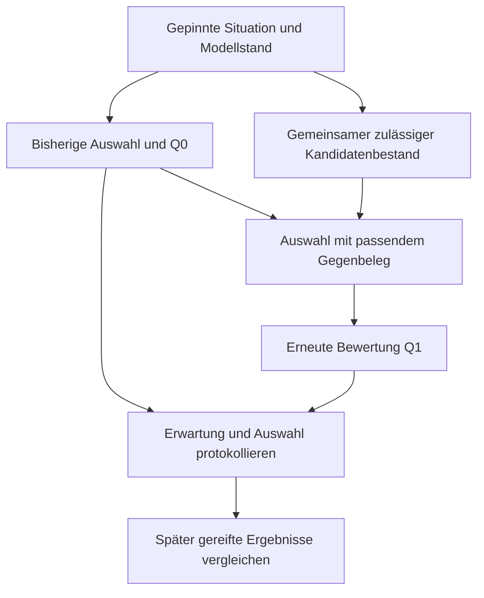

# C3P3 – Auswahl der Evidenz und Revision von Entscheidungen

**Konzeptversion:** V1  
**Datum:** 06.09.2026  
**Ausgangspunkt:** Monty-Hall-Problem, bestehender Atlas-Entwurf und Relations-/Workspace-Konzept  
**Status:** Zusammengefasstes Entwicklungs- und Versuchskonzept; noch keine Codeimplementierung und kein Nachweis einer Ergebnisverbesserung.

## 1. Ziel

Das Modell soll eine erste Aktionsbewertung anhand zusätzlicher verfügbarer Evidenz überprüfen. Es soll dabei berücksichtigen können, dass die gefundenen Erinnerungen durch eine bestimmte Suchregel ausgewählt wurden.

Die zentrale Hypothese lautet:

> Kontextuell passende Gegenbelege können eine selbstbestätigende Erinnerungsauswahl korrigieren und dadurch die Bewertung von SHORT, FLAT und LONG verbessern.

Geprüft wird der zusätzliche Nutzen der Auswahl und Verarbeitung. Ein Aktionswechsel erhält keinen eigenen Bonus. Beibehalten und Wechseln werden über dieselbe bestehende Ergebnisdefinition beurteilt.

Der Zusammenhang mit Calvinos verflochtenen Städtefolgen besteht in mehreren Zugängen zu derselben Erfahrung: zeitlicher Verlauf, ähnliche Geometrie, Handlungskontext sowie Unterstützung oder Einschränkung eines benannten Musters. Monty Hall ergänzt die Frage, was der jeweilige Auswahlweg über die Aussagekraft einer Information bedeutet.

## 2. Mathematische Grundlage und Grenze der Übertragung

Beim klassischen Monty-Hall-Problem ist der Gewinn gleich wahrscheinlich hinter einer von drei Türen. Nach der ersten Wahl öffnet ein informierter Moderator immer eine andere Tür ohne Gewinn und bietet immer den Wechsel an. Anfangs ist die erste Wahl mit Wahrscheinlichkeit 1/3 richtig und mit 2/3 falsch. Wechseln gewinnt genau in den Fällen der ursprünglich falschen Wahl. [1]

| Informationsmechanismus | Gewinnchance durch immer Wechseln |
|---|---:|
| Informierter Moderator entfernt immer eine Niete und bietet immer Wechsel an | 2/3 |
| Uninformierter Moderator öffnet zufällig eine ungewählte Tür; ausgewertet werden die Fälle mit geöffneter Niete | 1/2 |
| Moderator bietet den Wechsel ausschließlich bei ursprünglich richtiger Wahl an | 0 |

Die 2/3-Aussage der ersten Zeile gilt über alle Spiele. Für eine Aussage bedingt auf eine bestimmte geöffnete Tür muss auch die Öffnungsregel bekannt sein. Die übliche symmetrische Variante wählt bei zwei möglichen Nieten jede mit Wahrscheinlichkeit 1/2. [1, 2]

Allgemein beschreibt Bayes den Einfluss des Auswahlmechanismus:

\[
P(H\mid E,S,\pi_{sel})
\propto P(E\mid H,S,\pi_{sel})\,P(H\mid S,\pi_{sel}).
\]

Dabei bezeichnet H eine Hypothese, E die erhaltene Evidenz, S den bisherigen Informationsstand und π_sel die Auswahlregel. Eine vollständige Bayes-Schicht ist damit für C3P3 nicht festgelegt; die Gleichung beschreibt, welche Abhängigkeiten eine korrekte Interpretation beachten muss.

Für C3P3 gelten folgende Unterschiede:

- SHORT, FLAT und LONG besitzen keine vorgegebene gleiche Erfolgswahrscheinlichkeit.
- Memory und Forecaster kennen den tatsächlichen zukünftigen Verlauf nicht.
- Eine niedrig bewertete Aktion ist keine nachweislich falsche Tür.
- Das Entfernen des kleinsten vorhandenen Q-Wertes verbessert die verbleibende Rangfolge nicht von selbst.
- Das dokumentierte skalare Expectil-Q ist keine Gewinnwahrscheinlichkeit. τ=0,8 bezeichnet die Asymmetrie des Lernziels und keine Trefferquote von 80 Prozent. [3]

Aus dem Problem folgt deshalb keine allgemeine Wechselregel und kein Faktor 2/3 für die Aktionswerte.

## 3. Anschluss an den dokumentierten Modellstand

Die folgenden Anschlüsse stammen aus den bereits besprochenen Konzepten. Eine erneute Codeprüfung oder ein Trainingslauf ist nicht Bestandteil dieser Zusammenfassung.

| Bestandteil | Verwendung in diesem Konzept |
|---|---|
| Bestehende Local-, Geo- und Action-Cross-Komponenten | Erzeugen dieselben Ausgangsrepräsentationen für alle Vergleichsarme. |
| Gemeinsame Memory-/Core-Payloads | Bleiben maßgebliche Quelle vollständiger Erfahrungen und ihrer Herkunft. |
| Atlas | Liefert Suchsignaturen und Referenzen; keine zweite Kopie der Erfahrungen. |
| GeoKey24 und ACTION_CONTEXT | Unterstützen die Suche nach verwandter Geometrie und passenden Handlungsbedingungen. |
| Vorhandene Kontextbewertung und Memoryadapter | Bewerten die ausgewählten vollständigen Erinnerungen. |
| Geplanter Relationsgraph | Erschließt benannte Unterstützung, Gegenbelege, Kontextähnlichkeit und zeitliche Nachfolger. |
| Geplanter Workspace | Verarbeitet die gemeinsame Bedeutung von Situation, Aktionen und Erinnerungen. |
| Geplanter Szenarioplaner | Bleibt ein getrennt zu prüfender Ausbau. |

Der Relationsentwurf spezifiziert vier Atlas-Ausgangstreffer, höchstens eine Erweiterung über je vier Nachbarn, maximal 20 Kandidaten und anschließend die vorhandenen TopK4. Graph und Workspace sind dort als geplant ausgewiesen. Dieses Dokument präzisiert deren Auswertung; es behauptet nicht, dass diese Funktionen bereits im ausführbaren Modell vorliegen. [3, 4]

## 4. Welche Verzerrung untersucht wird

Eine Suchregel kann ihre eigene Bestätigung erzeugen. Beispiel: Eine erste Bewertung bevorzugt LONG. Eine danach ausschließlich auf erfolgreiche LONG-Fälle ausgerichtete Suche liefert überwiegend passende Erfolgsbeispiele. Deren Häufigkeit beschreibt dann auch die Suchregel.

Das ist eine zu prüfende Möglichkeit und keine Behauptung über einen bereits nachgewiesenen Fehler des aktuellen Retrievers.

Das Konzept trennt drei Sachverhalte:

1. **Fund:** Eine Quelle wurde aufgrund bestimmter Merkmale ausgewählt.
2. **Relevanz:** Ihre vollständigen Voraussetzungen passen zur aktuellen Situation.
3. **Nutzen:** Ihre Verwendung verbessert auf getrennten Daten die Bewertung oder Entscheidung.

Ein hoher Suchscore beweist weder Relevanz noch Nutzen. Mehrere Suchwege zu derselben Erfahrung ergeben keine zusätzlichen Beobachtungen. Auch verschiedene, stark überlappende Erfahrungen dürfen in der statistischen Auswertung nicht als vollständig unabhängig behandelt werden.

## 5. Was als Gegenbeleg zählt

Ein Gegenbeleg ist eine bereits verfügbare Erfahrung oder geprüfte Relation, welche die Gültigkeit einer benannten Aussage unter ihren Voraussetzungen einschränkt.

Beispiel einer Aussage: Ein bestimmtes geometrisches Muster begünstigt unter einem bestimmten Positions- und Kostenkontext LONG gegenüber FLAT. Ein verwendbarer Gegenbeleg muss sich auf diesen Vergleich und einen ausreichend passenden Kontext beziehen.

Für die erste Stufe gelten diese Regeln:

- Wiederverwendung vorhandener geprüfter Gegenbeleg-Relationen und ihrer Musterreferenzen.
- Prüfung vollständiger Herkunft, Generation, Datenrolle und Verfügbarkeit zum Wissensstand t.
- Vergleichbare Aktion, Ausgangsposition, Kosten- und Zielsemantik.
- Kein Gegenbeleg-Label allein aufgrund eines negativen historischen Gewinns oder eines niedrigen aktuellen Q-Wertes.
- Unterschiedliche Ergebnisse ähnlicher Situationen können durch fehlenden Kontext oder Zufall entstehen. Ein einzelner Fall beweist keine allgemeine Regel.

Fehlt eine passende geprüfte Gegenbeleg-Relation, bleibt die normale Auswahl erhalten. Dieser Fall wird als fehlende Abdeckung berichtet. Die Implementierung erzeugt dafür keine Ersatzwahrheit.

## 6. Entscheidungskreislauf

### 6.1 Ausgangsentscheidung

Q0 ist die vollständige bisherige Bewertung einschließlich ihrer normalen Memoryauswahl M0. Damit wird der tatsächlich verwendete Referenzpfad verglichen.

\[
a_0=\operatorname{argmax}_{a\in A_{legal}(S_t)} Q_0(S_t,a).
\]

Situation, Modellgewichte, Scaler, Kostenvertrag, Memorygeneration und Wissenscutoff werden für den Vergleich festgehalten. Identische Ausgangsrepräsentationen werden wiederverwendet.

### 6.2 Kontrollierte Änderung der Auswahl

Der Versuch verändert die Auswahl eines Erinnerungssatzes. Er addiert nicht nachträglich eine zweite vollständige Memorykorrektur auf die erste.

Aus demselben Ausgangszustand wird Q1 mit dem alternativen Erinnerungssatz M1 über denselben Kontextpfad berechnet:

\[
a_1=\operatorname{argmax}_{a\in A_{legal}(S_t)} Q_1(S_t,a).
\]

Vorhandene Legalitätsmasken und Tie-Break-Regeln gelten in allen Armen unverändert. Alle legalen Aktionen bleiben Gegenstand der Bewertung.

### 6.3 Erneute Bewertung

Zuerst wird die Auswahl bei festem bestehendem Kontextpfad untersucht. Ein späterer Versuch kann bei identischer Auswahl den geplanten Workspace prüfen. Dadurch bleiben Auswahlwirkung und zusätzliche Rechenverarbeitung unterscheidbar.

Während der einzelnen Entscheidung werden keine Gewichte angepasst. Erst ein späterer zulässiger Trainingsschritt nutzt gereifte Daten.

## 7. Erster Vergleichsversuch

### 7.1 Gemeinsame Bedingungen

Alle Arme erhalten dieselben Entscheidungszustände, eingefrorenen Gewichte, zulässigen Quellen, Kandidatenbudgets, Kostenregeln und vier Memoryplätze. Als Kandidatenbestand wird die Vereinigungsmenge der vorhandenen Ausgangstreffer und der nach dem bestehenden Relationsvertrag zulässigen Nachbarn verwendet. Nach Ausschluss ungültiger und doppelter Referenzen bleibt die Grenze von 20 Kandidaten bestehen.

Fehlt die Relationsfunktion im Code, wird zunächst die Protokollierung an der bestehenden Auswahl umgesetzt. Ein Gegenbeleg-Versuch setzt echte verfügbare Beziehungen voraus.

### 7.2 Drei Arme

| Arm | Auswahl | Zweck |
|---|---|---|
| 0 – Referenz | Bestehende Rangfolge, normale TopK4 | Bisherige Entscheidung Q0 |
| 1 – Zufallskontrolle | Höchstens einen Slot durch einen anderen zulässigen Kandidaten ersetzen | Wirkung einer bloßen Variation messen |
| 2 – Gegenbeleg | Höchstens einen Slot durch einen passenden geprüften Gegenbeleg ersetzen | Wirkung gezielter Gegeninformation messen |

Die Varianten sind Diagnosearme, keine neuen Laufzeitphasen.

**Auswahlregel für Arm 2:** Unter den zum Zeitpunkt t zulässigen, bisher nicht ausgewählten Kandidaten werden nur Gegenbelege mit auflösbarer Musterreferenz berücksichtigt, deren Voraussetzungen zum aktuellen Kontext und zur in Q0 bevorzugten Aktion passen. Aus diesen wird der Kandidat mit dem besten vorhandenen Retrievalrang gewählt. Er ersetzt den am schlechtesten gerankten ausgewählten Treffer, sofern noch kein solcher Gegenbeleg in M0 enthalten ist. Ist ein geeigneter Gegenbeleg bereits vorhanden oder fehlt ein neuer geeigneter Kandidat, bleibt M0 bestehen.

**Auswahlregel für Arm 1:** Auf genau den Zuständen, auf denen Arm 2 einen Ersatz vornehmen kann, wird derselbe Slot durch einen gleichverteilt gezogenen zulässigen Kandidaten außerhalb von M0 ersetzt. Ein zur Diagnose festgehaltener Zufallsstream macht die Auswahl reproduzierbar. Der Kandidat darf zufällig auch ein Gegenbeleg sein; dieser Anteil wird berichtet.

Die erste Auswertung umfasst sowohl alle Zustände als auch separat die Zustände mit tatsächlich möglichem Ersatz. Ein neutraler unveränderter Satz wird nicht als erfolgreiche Gegenbelegprüfung gezählt.

### 7.3 Datenrollen und Training

Die Auswahl verwendet ausschließlich damals verfügbare Evidenz. Gereifte Outcomes früherer zulässiger Quellen dürfen nach ihrem bestehenden Vertrag genutzt werden; der zukünftige Outcome der aktuellen Anfrage darf niemals deren Auswahl bestimmen.

Der erste Versuch ist ein Vergleich bei festem Modell. Auswahlparameter werden auf den dafür vorgesehenen Entwicklungs-/Validierungsrollen festgelegt. TEST dient anschließend der abschließenden Bewertung und nicht der Wahl von Retrievalregel, Schwelle oder Modellvariante.

Falls später ein Training des Workspace hinzukommt, bleiben vorhandene Sourcegruppen, Datenrollen und Lernziele maßgeblich. Die drei Diagnosearme erzeugen keine drei neuen unabhängigen Erfahrungen. Revisionsdiagnostik wird nicht als zusätzlicher Wechselreward in Main-Q oder Core eingespeist.

## 8. Ergebnisse und Messgrößen

### 8.1 Vergleichbare Folgen

Für jeden Zustand werden die legalen ersten Aktionen am selben später realisierten Marktpfad mit dem bestehenden Environment nachgerechnet. Nach der ersten Aktion verwenden alle Zweige dieselbe eingefrorene Fortsetzungspolicy, die auf dem jeweiligen Zweigzustand entscheidet.

Gleiche Policy bedeutet dieselbe Entscheidungsfunktion; durch unterschiedliche Positionen können ihre Folgeaktionen verschieden sein. Ausführungsregeln, Kostenmodell, Zeitpunkt und Abschlussregeln bleiben gleich. Gemeinsame exogene Zufallsgrößen werden bei stochastischer Ausführung gepaart verwendet. Der Vergleich gilt unter dem bestehenden Ausführungsmodell und dessen Annahme über den Markteinfluss der eigenen Aktionen.

### 8.2 Begrenzter Return und gebootstrapptes Target

Der bereits spezifizierte Horizont N3 entspricht drei RL-Übergängen. Im Relations-/Szenariovertrag sind das 18 handelbare Minutenbars plus End-OPEN; Gamma beträgt 0,96. [4]

Für eine erste Aktion a sei der ausschließlich aus den drei gereiften Übergängen berechnete diskontierte Return:

\[
G^{(3)}_t(a)=\sum_{k=0}^{2}\gamma^k r_{t+k+1}^{(a)}.
\]

Verwendet wird die bestehende Rewardsemantik mit ihren Kosten. Das ist ein begrenzter Ergebnisvergleich und noch kein vollständiger langfristiger Wert. Eine zusätzliche erfundene Zwangsschließung am Diagnosehorizont wird nicht eingeführt. Erreicht ein Zweig einen echten Endzustand, gelten dessen vorhandene Abschluss- und Bootstrapregeln.

Davon getrennt wird nach bestehendem Targetvertrag ausgewiesen:

\[
Y^{(3)}_t(a)=G^{(3)}_t(a)+\gamma^3 m_t^{(a)}V_{ref}(S_{t+3}^{(a)}),
\]

wobei m den zulässigen Bootstrap maskiert und V_ref den festgehaltenen vorhandenen Bootstrapoperator bezeichnet. Dessen Aktionsauswahl, Targetnetz und Legalitätsregeln bleiben unverändert; ein Q-Learning-Operator wird nicht stillschweigend durch den Wert der Fortsetzungspolicy ersetzt. Y enthält eine Modellschätzung. Es darf nicht als vollständig beobachteter Return bezeichnet werden. Bei früherem Episodenende greift der bestehende, entsprechend verkürzte N-Step-Vertrag.

Die Ergebniswerte werden einmal pro Ausgangszustand, erster Aktion und Fortsetzungsvertrag berechnet und zwischen den Diagnosearmen wiederverwendet. Jeder Zweig sieht an einer Folgeentscheidung nur den bis dahin verfügbaren Marktpräfix. Modellstand und zulässiger Memorybestand bleiben für den Vergleich gepinnt.

### 8.3 Qualität einer Revision

\[
\Delta G_t=G^{(3)}_t(a_1)-G^{(3)}_t(a_0).
\]

| Diagnose | Definition |
|---|---|
| Wechselrate | Anteil mit a1 ungleich a0 |
| Im realisierten Verlauf hilfreicher Wechsel | a1 ungleich a0 und ΔG > 0 |
| Im realisierten Verlauf schädlicher Wechsel | a1 ungleich a0 und ΔG < 0 |
| Ergebnisgleicher Wechsel | a1 ungleich a0 und ΔG = 0 |
| Rückblickend verpasste Verbesserung | a1 = a0, obwohl eine andere legale erste Aktion unter demselben Vergleichsvertrag einen höheren G-Wert erzielt hätte |
| Mittlerer Revisionsnutzen | Mittelwert von ΔG über alle gepaarten Zustände |
| Verbleibender rückblickender Regret | Höchster G-Wert einer legalen ersten Aktion abzüglich des G-Wertes der gewählten Aktion a1 |
| Zusätzlicher Wert der Gegenbelegregel | Gepaarter G-Unterschied zwischen Arm 2 und Arm 1 |
| Abdeckung | Anteil der Zustände mit vorhandenem bzw. neu nutzbarem geprüftem Gegenbeleg |

Die Klassen sind rückblickende Diagnosen. Ein einzelner hilfreicher Wechsel beweist keine ex ante richtige Überzeugung; ein schädlicher Wechsel beweist keine grundsätzlich falsche Suchregel. Begrenzter Return, gebootstrapptes Target und vollständiges Episode-Ergebnis werden getrennt berichtet.

Zusätzliche Messgrößen: Veränderungen der Aktionsabstände Q(a)−Q(b), vorhandene Expectil-Loss auf korrekt definierten Targets, tatsächliche Quellenzahl, doppelte Referenzen, Laufzeit je Entscheidung und Speicherbedarf. Eine größere Q-Differenz ist allein kein Nachweis höherer Sicherheit.

Überlappende Entscheidungsfenster und gemeinsame Quellen machen Beobachtungen abhängig. Unsicherheitsangaben müssen deshalb zusammenhängende Zeitblöcke bzw. Episoden berücksichtigen. Einzelne Zustände werden nicht als unabhängige Replikate ausgegeben.

## 9. Protokollierung und Herkunft

Vor der tatsächlichen Beobachtung wird ein Diagnoseeintrag über den vorhandenen Artifactwriter angelegt. Er ist kein zusätzlicher Replaystore.

| Feldgruppe | Inhalt |
|---|---|
| Identität | Bestehende Zustands-/Sourcegruppenreferenz, Entscheidungszeit, Wissenscutoff und Datenrolle |
| Reproduzierbarkeit | Modell-, Scaler-, Kosten-, Retrieval- und Memorygeneration sowie Zufallsstream |
| Ausgang | Q0 für drei Aktionen, Legalitätsmaske, a0 und ausgewählte vollständige Referenzen M0 |
| Auswahlweg | Arm, Kandidaten, Rang, Grund einer Auswahl, Muster- und Gegenbelegreferenz |
| Neubewertung | M1, Q1, a1 und Änderungen der Aktionsabstände |
| Spätere Ergänzung | Verfügbarkeitszeit, gereifte Return-/Targetwerte, Ausführungsherkunft und Revisionsdiagnose |
| Aufwand | Tatsächliche Kandidatenzahl, Materialisierungen, Laufzeit und Speicherverbrauch |

Bereits vorhandene Identitäts- und Metadatenfelder werden referenziert. Die Auswahlregel wird in V1 durch Protokollierung und getrennte Versuchsauswertung berücksichtigt. Ein trainierter Korrekturmechanismus für unbekannte Auswahlwahrscheinlichkeiten wird nicht als vorhanden behauptet.

## 10. Einordnung der Szenarioplanung

Der bestehende Entwurf erzeugt 16 Zufallsziehungen aus einer bedingten Marktverteilung. Jede Ziehung umfasst 18 Minutenkerzen und End-OPEN; die Geometrie wird daraus mit derselben kausalen Berechnung abgeleitet. Alle ersten Aktionen erhalten dieselben Marktpfade. [4]

Diese Szenarien liefern modellierte Konsequenzen und keine unabhängigen Bestätigungen der tatsächlichen Zukunft. Der deterministische Geometriefork prüft die Konsequenz eines Pfades; seine Eintrittswahrscheinlichkeit stammt aus dem Forecaster und muss separat bewertet werden.

Fest definierte Prozent-Stresspfade behalten ihren Diagnosecharakter und erhalten durch dieses Konzept keine erfundenen Wahrscheinlichkeiten. Gezogene Pfade dürfen nicht nachträglich nur deshalb bevorzugt werden, weil sie a0 bestätigen. Eine Auswertung ausschließlich des später am besten passenden Samples wäre kein ausreichender Test der gesamten Prognoseverteilung.

Der erste Monty-Hall-Transfer untersucht Retrieval und Revision. Ein anschließender eigener Vergleich kann den zusätzlichen Nutzen des Planers messen, nachdem die Auswahlwirkung bekannt ist.

## 11. Geordnete Umsetzung

| Teilprojekt | Konkretes Ergebnis | Abhängigkeit |
|---|---|---|
| A – Referenz und Diagnose | Q0, a0, Quellen und Auswahlweg reproduzierbar erfassen | Bestehender Modellpfad |
| B – Verfügbarkeit und Relationen | Geprüfte Gegenbelege im gemeinsamen Kandidatenbestand auflösen | Vorhandene Identitätsautorität und Relationsentwurf |
| C – Drei Auswahl-Arme | Referenz, Zufallskontrolle und gezielter Ersatz bei identischem Budget | A und B |
| D – Gepaarte Auswertung | Gereifte G-, Y- und Episode-Ergebnisse sowie Kosten und Aufwand vergleichen | C und bestehendes Env |
| E – Lernen mit unveränderter Zielsemantik | Bei belegtem Defizit vorhandenen Kontextpfad/Workspace auf zulässigen Trainingsrollen verbessern | Auswertung D und bestehender Workspace-Plan |
| F – Szenarioplanung getrennt bewerten | Zusätzlichen Nutzen des vorhandenen Planerentwurfs messen | Abgeschlossene Vergleichsbasis |

Diese Teilprojekte erweitern die bestehenden Zuständigkeiten. Die numerische Hauptfolge PHASE=1..16 und die vorhandenen Konfigurationsgruppen bleiben maßgeblich. Diagnose- und Versuchsparameter gehören in RL_PARAMS; bestehende Budget-, Seed-, Kosten- und Zielparameter werden wiederverwendet. Die bestehende Vortrainingsobergrenze von zehn Epochen bleibt erhalten.

Das Konzept führt keine neue Freigabesperre und keinen automatischen Wechselmechanismus ein. Die ersten Prüfungen sind kurze Funktions- und Vergleichsläufe. Umfangreiche Trainings- oder GPU-Läufe gehören nicht zu dieser Zusammenfassung.

## 12. Erfolgskriterium und Entscheidungsgrenze

Die Hypothese wird unterstützt, wenn die gezielte Gegenbelegauswahl auf zeitlich getrennten Daten gegenüber Referenz und Zufallskontrolle einen reproduzierbaren zusätzlichen Nutzen liefert, ohne diesen lediglich durch höheres Rechenbudget, andere Kosten oder unzulässige Zukunftsinformation zu erhalten.

Ein Nutzen nur gegenüber der Referenz, aber nicht gegenüber der Zufallskontrolle, spricht zunächst für den Wert zusätzlicher Variation. Er belegt noch keinen besonderen Vorteil der Gegenbelegsemantik.

Monty Hall begründet die Aufmerksamkeit für den Informationsmechanismus. Ob daraus für C3P3 bessere Entscheidungen entstehen, beantwortet der beschriebene Vergleich.

## 13. Quellen und Bezugskonzepte

1. [MIT, Meyer und Rubinfeld: Introduction to Probability, Monty Hall und alternative Moderatorregel](https://ocw.mit.edu/courses/6-042j-mathematics-for-computer-science-fall-2005/56a41986aa7ab49261e3ff80017e8cf4_ln12.pdf).
2. [MIT, Introduction to Probability and Statistics: Problem Set 07, informierter und zufällig öffnender Moderator](https://ocw.mit.edu/courses/18-05-introduction-to-probability-and-statistics-spring-2022/mit18_05_s22_pset07.pdf).
3. [C3P3_NEXT_LEVEL_GLOBAL_MEMORY_ATLAS_KONZEPT_V1.md](https://chatgpt.com/api/library/files/libfile_0ed737b42e1c8191b649ebb3466bf281/download), 06.09.2026: Atlas als Index, vollständige Erfahrungen, Kontextbewertung und dokumentierter Modellstand.
4. [C3P3_RELATION_WORKSPACE_SZENARIEN_UMSETZUNGSKONZEPT_V1.md](https://chatgpt.com/api/library/files/libfile_f3b118507428819188b4b2097092a1f4/download), 06.09.2026: geplante Relationen, Workspace, kausale Datenrollen und Szenarioplanung.

Die Übertragung, die Auswahl-Arme und die Revisionsdiagnostik dieses Dokuments sind ein eigener Entwurf für C3P3. Die mathematischen Quellen bestätigen keine Leistung dieses Entwurfs auf Marktdaten.
